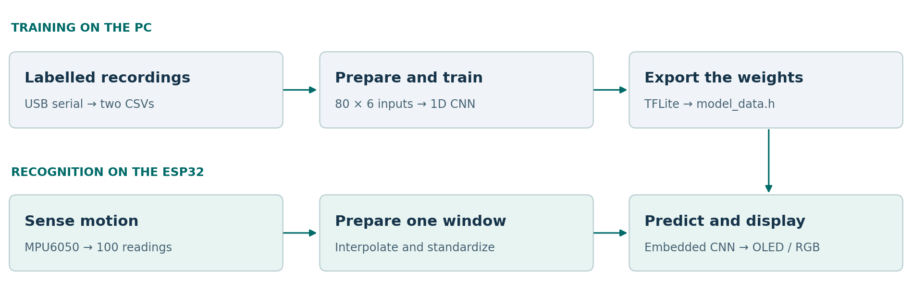
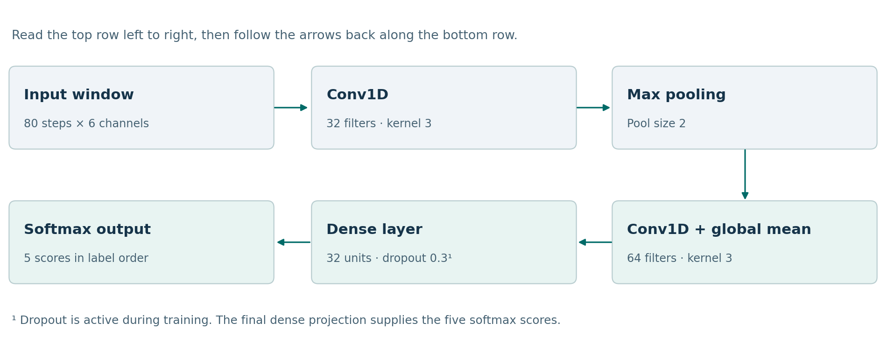

# ESP32 hand gesture recognition

An ESP32-WROOM-32 recognizes **UP, DOWN, LEFT, RIGHT, and IDLE** from a handheld MPU6050. A small one-dimensional convolutional neural network (1D CNN) runs on the board. The OLED shows the decision, confidence, and inference time. An RGB LED gives immediate visual feedback. The laptop is used for collection and training. Live recognition works offline.

**[Read the illustrated project guide (PDF)](docs/Gesture_AI_Project_Guide.pdf)** · [Check the data](#verify-the-included-data) · [Inspect the ESP32 results](results/evidence/)



## Results

| Check | Result | What it measures |
| --- | --- | --- |
| Independent test | **140/150 correct (93.33%)** | One prediction per separately collected recording, 30 per class |
| Python and ESP32, same five inputs | **5/5 predictions matched** | Both runtimes returned the same class on each input |
| Ground truth on those five inputs | **4/5 correct** | Both runtimes called the same LEFT example IDLE |
| ESP32 inference time | **78.72 ms average** | Model execution across the five parity examples |
| Deployed model | **41,608 bytes (40.63 KiB)** | Size of the TensorFlow Lite model file |

The live device collects approximately two seconds of motion before invoking the model. Its response time includes that capture window. All five live gestures were demonstrated. The independent test above supplies the measured classification accuracy.

## Hardware

| ESP32 DevKit V1 | Connection |
| --- | --- |
| 3V3 and GND | Power and common ground for the GY-521 MPU6050 and 0.96-inch I²C OLED used in this build |
| GPIO21 / GPIO22 | Shared SDA / SCL for both devices; project addresses 0x68 (IMU) and 0x3C (OLED) |
| GPIO25, GPIO26, GPIO27 | Red, green, blue LED channels respectively, each through a 220 Ω resistor |
| GND | Common cathode of the four-pin RGB LED |
| USB | Power, upload, and serial output at 115200 baud |

The output mapping is DOWN → red, IDLE → off, LEFT → blue, RIGHT → cyan, UP → green. The live sketch uses yellow for UNCERTAIN when the highest score falls below 70%. UNCERTAIN is a firmware decision outside the five model classes.

## Data and model

| File | Recordings | Raw rows | Role |
| --- | ---: | ---: | --- |
| [gesture_dataset.csv](data/gesture_dataset.csv) | 100 | 8,723 | 80 training and 20 validation |
| [gesture_dataset_new.csv](data/gesture_dataset_new.csv) | 150 | 32,840 | Independent test |

Each CSV row contains `sample_id,timestamp,ax,ay,az,gx,gy,gz,label`. Group rows by file and sample ID. Keep the six axes in the shown order and sort each recording by timestamp. Each recording is linearly resampled to 80 steps. Use the six training-set means and standard deviations to standardize each axis. A model input contains 480 values. The output vector follows **DOWN, IDLE, LEFT, RIGHT, UP**.



The training run used two Conv1D stages, max pooling, global average pooling, a 32-unit dense layer, training-only dropout, and five softmax outputs. Adam minimized sparse categorical cross-entropy. Batch size was 8, with a 60-epoch limit and early stopping on validation loss. See the guide for model conversion, operator registration, and board bring-up.

## Verify the included data

From the repository root on Windows, run this with Python 3. The check uses only the standard library.

```powershell
py -3 tools/check_data.py
```

On Linux or macOS, use `python3 tools/check_data.py`. The checker verifies the CSV schema, finite readings, label consistency, and recording counts. It recomputes 93.33% from the [archived confusion matrix](results/confusion_matrix.csv). The trained weights are included in the firmware header.

## Run the live device

1. Open [Gesture_AI_Live.ino](firmware/Gesture_AI_Live/Gesture_AI_Live.ino) in Arduino IDE. Keep [model_data.h](firmware/Gesture_AI_Live/model_data.h) beside it. The header already contains the trained model.
2. Select **ESP32 Dev Module**, your board’s USB port, and the Espressif ESP32 board package. The project used IDE **2.3.11** and board package **4.0.0**.
3. In Library Manager install **Adafruit MPU6050**, **Adafruit Unified Sensor**, **Adafruit GFX Library**, **Adafruit SSD1306**, and **Chirale_TensorFlowLite**. Accept their dependencies.
4. Upload, then open Serial Monitor at **115200 baud**. Wait for `System ready!`. Hold still for IDLE, then try a single deliberate movement in a capture window. Compare the serial label, OLED, and LED.

The sketch configures the IMU to ±8 g, ±500 degrees/s, and a 21 Hz filter bandwidth. It captures 100 readings at a target interval of 20 ms, resamples them to 80 time steps, and invokes a float32 model with an 80 KiB tensor arena. The confidence threshold is 0.70. The scaler and five labels are in the sketch.

## Retrain on the supplied recordings

Use a Python environment with TensorFlow, NumPy, pandas, scikit-learn, and matplotlib. From the repository root in PowerShell:

```powershell
cd data
python ../training/preprocess_v2.py
python ../training/train_model_v2.py
```

The [preprocessor](training/preprocess_v2.py) reads both CSVs by filename, splits the original recordings with stratification and a fixed split seed of 42, and writes six arrays and `scaler_params_v2.npz` into the current directory. The [training script](training/train_model_v2.py) reads those arrays, saves `gesture_cnn_v2.keras`, evaluates the independent recordings, and produces training and evaluation plots. Newly trained weights can vary. To deploy a retrained version, convert it to TensorFlow Lite, regenerate the model header, and keep the corresponding scaler and class order with it.

The [five saved test windows](results/validation/test_samples.h) are included for the original Python–ESP32 comparison. The live sketch reads from the motion sensor.

**Verification.** Re-running the supplied preprocessor produced the documented splits. Its scaler matched the constants in the sketch. A desktop NumPy replay using the weights extracted from the firmware header reproduced every cell of the independent-test confusion matrix. The reported ESP32 timing comes from the original board capture.

**Author** · Kaushik N. · Electronics and Communication Engineering, Chennai Institute of Technology
